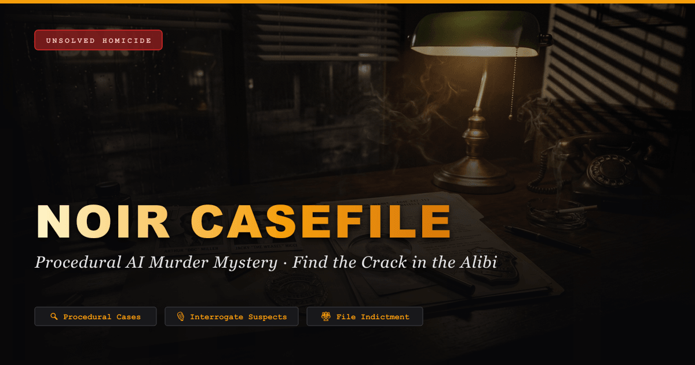
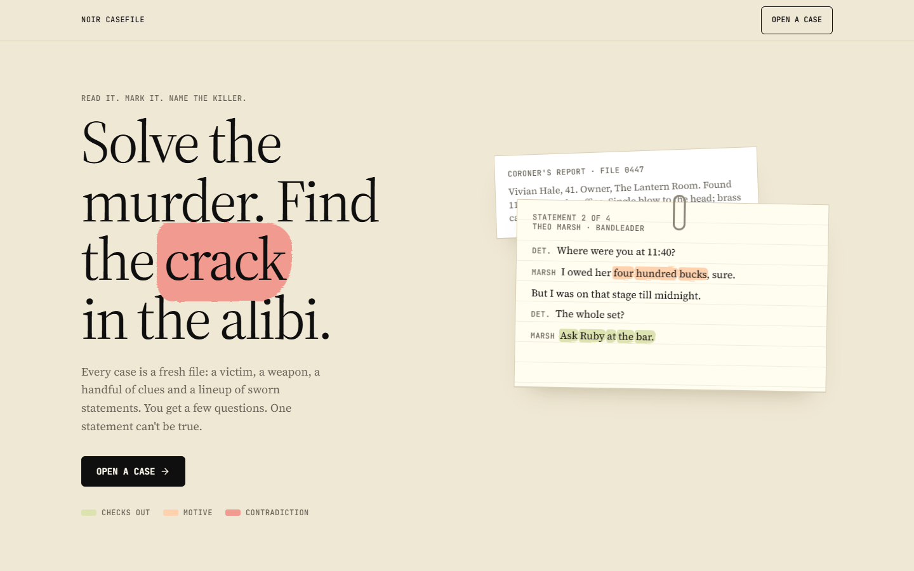
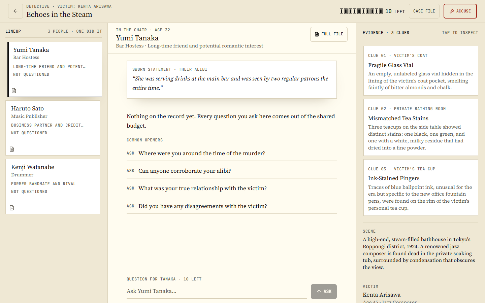
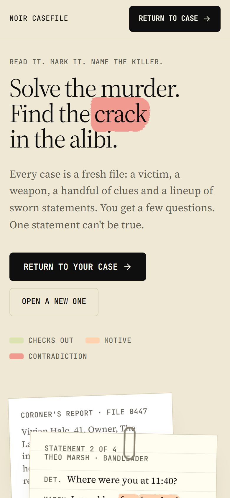
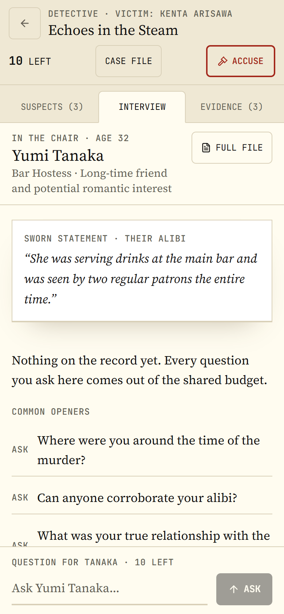

<div align="center">



# Noir Casefile

**A murder mystery game where AI writes a new case every time you play.**

</div>

## What is it?

Someone has been murdered. You're the detective.

1. **Read the case.** You get a victim, a crime scene, some clues and a few suspects.
2. **Ask questions.** Talk to the suspects. You only get a few questions, shared between all of them, so choose carefully.
3. **Find the lie.** One suspect is the killer, and their story has a hole in it.
4. **Make your accusation.** Name the killer, the weapon and the clue that proves it. Get all three right to win.

Every case is made up fresh by AI, so no two games are the same. Your game saves automatically, so you can close the tab and come back later.

## Screenshots

### Desktop





### Mobile

<p>
  
  &nbsp;
  
</p>

## Difficulty levels

| Level | Suspects | Questions | The killer is... |
|---|---|---|---|
| Rookie | 3 | 12 | nervous and slips up easily |
| Detective | 3 | 10 | evasive about details |
| Hardboiled | 4 | 10 | calm, with a red herring suspect to fool you |
| Noir | 5 | 8 | ice-cold, with several red herrings |

## Run it yourself

You need [Node.js](https://nodejs.org/) and a free [Groq API key](https://console.groq.com/keys).

```bash
git clone https://github.com/denzeltl/noir-casefile.git
cd noir-casefile
npm install
cp .env.example .env.local
```

Open `.env.local` and paste your key:

```env
GROQ_API_KEY=your_key_here
```

Then start it:

```bash
npm run dev
```

Go to [http://localhost:3000](http://localhost:3000) and open a case.

**Tip:** If you hit Groq's free rate limit, add a second key as `GROQ_API_KEY_BACKUP`. The game switches to it automatically.

## Ad Studio

Behind `/admin` there's a small studio that turns finished cases into 15-second vertical trailers. You pick which cases get an ad. AI writes and scores the hooks, you approve them, your PC renders the video, and you post it by hand.

### The graph

```
brief ─▶ hookWriter ─▶ critic ─┬─▶ pickHook ─▶ storyboardWriter ─▶ render ─▶ approveVideo ─▶ done
              ▲                │   (you)                            (PC)       (you)
              └── best < 7/10 ─┘      │ rewrite                        ▲            │ re-render
              (max 3 drafts)          └──▶ hookWriter                  └────────────┘
```

- **hookWriter** (Groq) writes five hooks from the spoiler-free brief. The full case, with the killer and the solution, never enters the graph.
- **critic** (Gemini) scores them out of 10. If the best is under 7, the writer gets the critique and tries again, up to three drafts.
- **pickHook** pauses for you: pick a hook, edit it, or ask for a rewrite with a note.
- **storyboardWriter** turns the hook into on-screen text for the trailer template.
- **render** pauses until the render worker on your PC has made the MP4 with HyperFrames and uploaded it.
- **approveVideo** pauses for you again: approve it, re-render it or discard it.

Each run page shows a timeline of the steps it went through, with times and the models used. A failed run says which step broke, and **Retry run** runs that step again without redoing the work before it. A run that stops making progress for 10 minutes is marked as stalled and can be retried the same way.

### Why LangGraph

- **Loops.** The writer and critic loop is a conditional edge with a hard limit, not hand-written retry code.
- **Durable pauses.** The two human decisions and the render handoff are `interrupt()`s. The run's state is checkpointed in Postgres, so a run can wait for days, survive a server restart, and resume exactly where it stopped. The render worker on your PC resumes it the same way the admin does.
- **Two providers.** Each step names a primary and a fallback model. When Groq or Gemini hits a free-tier rate limit, that step switches to the other provider instead of failing the run.

### Run it

You also need a [Supabase](https://supabase.com/) project and a [Gemini API key](https://aistudio.google.com/apikey).

1. Run `supabase/schema.sql` in the Supabase SQL editor.
2. Add the Ad Studio variables from `.env.example` to `.env.local`: `NEXT_PUBLIC_SUPABASE_URL`, `SUPABASE_SERVICE_ROLE_KEY`, `DATABASE_URL`, `GOOGLE_API_KEY`, `ADMIN_PASSWORD`, `N8N_SHARED_SECRET` and `AD_STUDIO_URL`.
3. Run `npm run dev` and open [http://localhost:3000/admin](http://localhost:3000/admin). Every case a player opens appears there.
4. To render videos, keep `npm run render-worker` running on your PC.
5. Optional: Telegram alerts and a **Create ad** button in Telegram. See [n8n/README.md](n8n/README.md).

To try the graph without the admin, `npm run ad-graph` runs it once on the newest saved case (or `npm run ad-graph -- <caseId>`), in memory.

## Built with

Next.js, React, Tailwind CSS, Motion, and Groq (`qwen/qwen3.8-27b`) for the AI.

## License

MIT. See [LICENSE](LICENSE).
