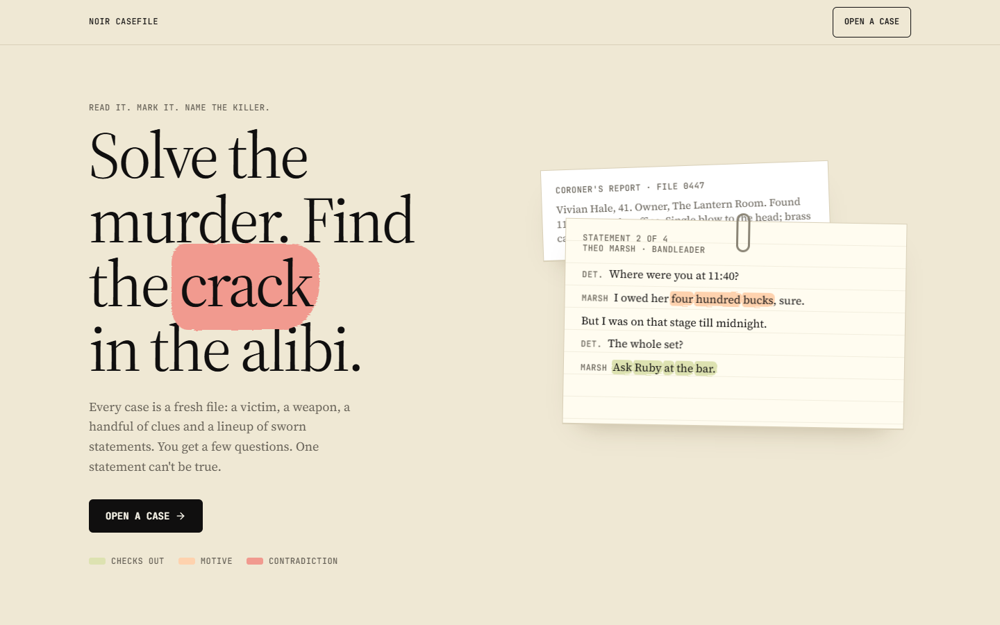
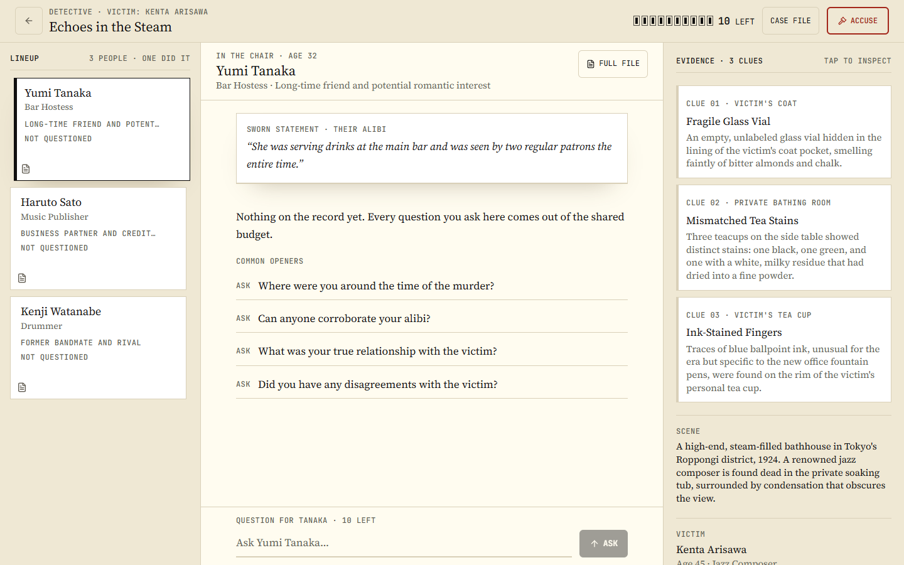
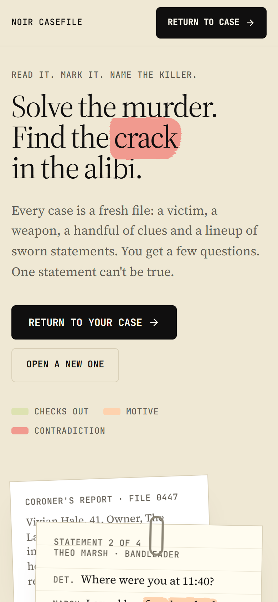
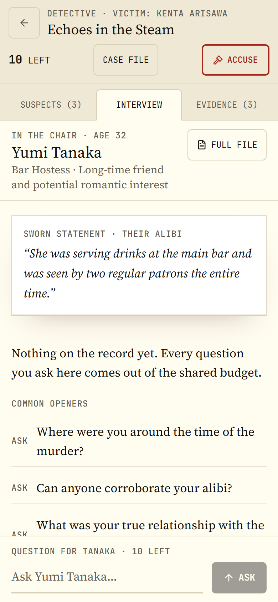

<div align="center">


# Noir Casefile

**A murder mystery game where AI writes a new case every time you play.**

</div>

## What is it?

Someone has been murdered. You're the detective.

1. **Read the case.** You get a victim, a crime scene, some clues and a few suspects.
2. **Ask questions.** Talk to the suspects. You only get a few questions, shared between all of them, so choose carefully.
3. **Find the lie.** One suspect is the killer, and their story has a hole in it.
4. **Make your accusation.** Name the killer, the weapon and the clue that proves it. Get all three right to win.

Every case is made up fresh by AI, so no two games are the same. Your game saves automatically, so you can close the tab and come back later.

## Screenshots

### Desktop





### Mobile

<p>
  
  &nbsp;
  
</p>

## Difficulty levels

| Level | Suspects | Questions | The killer is... |
|---|---|---|---|
| Rookie | 3 | 12 | nervous and slips up easily |
| Detective | 3 | 10 | evasive about details |
| Hardboiled | 4 | 10 | calm, with a red herring suspect to fool you |
| Noir | 5 | 8 | ice-cold, with several red herrings |

## Run it yourself

You need [Node.js](https://nodejs.org/) and a free [Groq API key](https://console.groq.com/keys).

```bash
git clone https://github.com/denzeltl/noir-casefile.git
cd noir-casefile
npm install
cp .env.example .env.local
```

Open `.env.local` and paste your key:

```env
GROQ_API_KEY=your_key_here
```

Then start it:

```bash
npm run dev
```

Go to [http://localhost:3000](http://localhost:3000) and open a case.

**Tip:** If you hit Groq's free rate limit, add a second key as `GROQ_API_KEY_BACKUP`. The game switches to it automatically.

## Built with

Next.js, React, Tailwind CSS, Motion, and Groq (`qwen/qwen3.8-27b`) for the AI.

## License

MIT. See [LICENSE](LICENSE).
