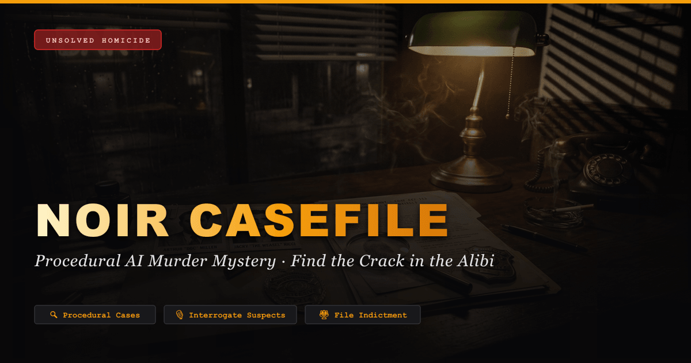
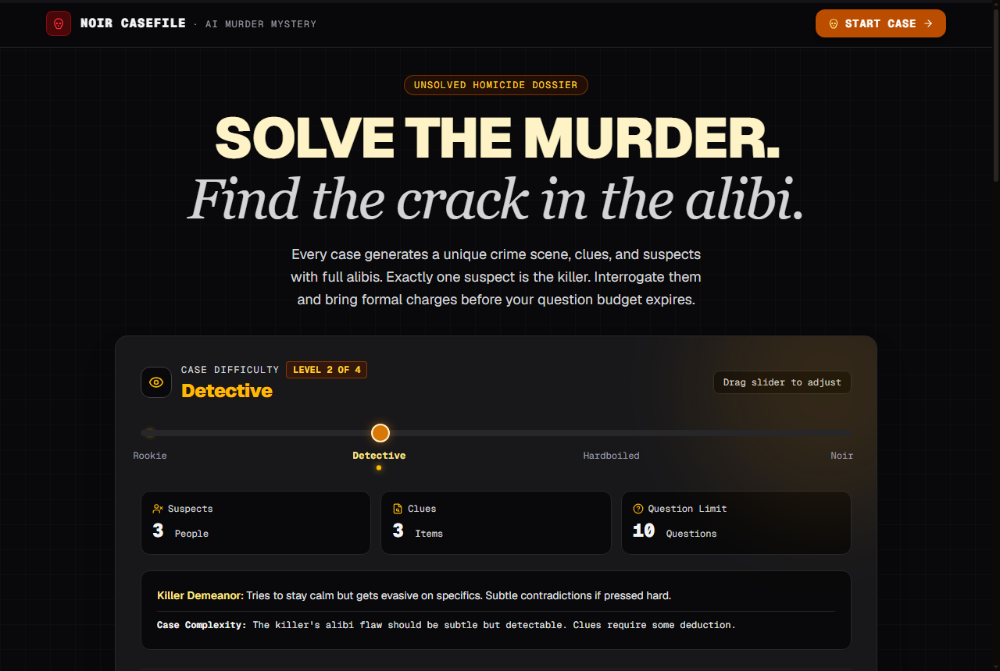
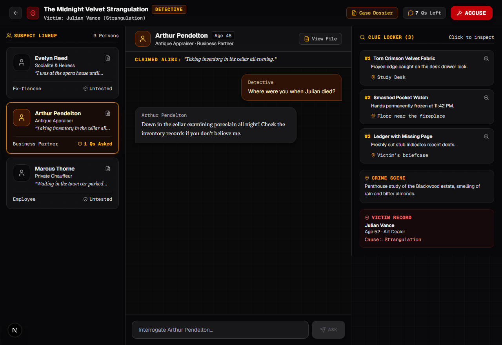
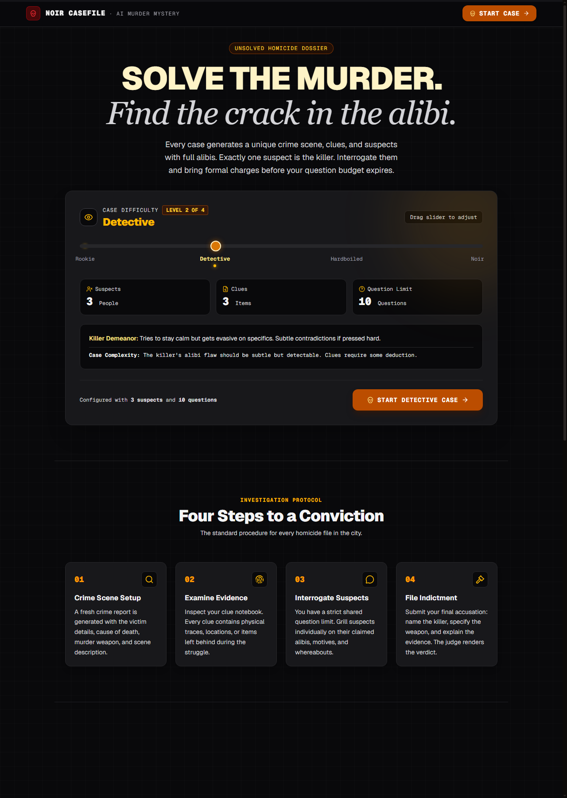
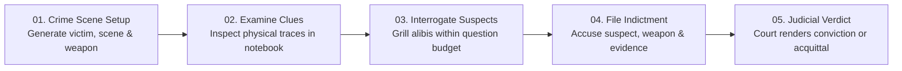

<div align="center">



# 🕵️‍♂️ Noir Casefile
### *A Procedurally Generated AI Murder Mystery Game*

[](https://nextjs.org/)
[](https://react.dev/)
[](https://www.typescriptlang.org/)
[](https://tailwindcss.com/)
[](https://groq.com/)
[](https://opensource.org/licenses/MIT)

<p align="center">
  <strong>"Solve the murder. Find the crack in the alibi."</strong><br>
  Step into the shadows of a 1940s hardboiled crime drama. Every case generates a unique crime scene, physical evidence, and suspect roster with full alibi consistency. Interrogate suspects under a strict question budget, detect contradictions, and file your formal indictment.
</p>

[Play Demo](#getting-started) • [Features](#-key-features) • [Investigation Protocol](#-investigation-protocol) • [Architecture](#-tech-stack--architecture) • [Deploy](#-deployment)

</div>

---

## 📸 Visual Showcase

### 🔍 Case Launchpad & Difficulty Selection
Select your challenge level from **Easy** to **Noir**, review active investigation dossiers, or launch a fresh unsolved homicide file.

<div align="center">
  
</div>

<br />

### 🕵️ Investigation Room & Interrogation Terminal
Inspect the crime scene header, examine suspect alibis, browse physical clues, and grill suspects one question at a time.

<div align="center">
  
</div>

<br />

### 📜 Protocol, Dynamics & Detective Field Manual
Every case adheres to strict forensic rules: exactly one killer, exactly one murder weapon, and logical alibi consistency.

<div align="center">
  
</div>

---

## ⚡ Key Features

* **Infinite Procedural Cases**: Every playthrough generates a completely original homicide casefile—victim history, murder weapon, crime scene, clues, and suspect backgrounds powered by high-speed Groq AI inference (`qwen/qwen3.8-27b`).
* **Strict Forensic Consistency**:
  * Exactly **one suspect** is the killer with a flawed alibi containing a logical contradiction.
  * All other suspects are innocent with verifiable alibis.
  * The murder weapon always aligns with the cause of death.
* **Shared Question Economy**: Questions are pooled globally. Every inquiry spent on one suspect leaves fewer opportunities to grill the others.
* **Hardboiled Suspect Interrogations**: Suspects respond in concise, in-character noir dialogue (1–2 sentences max). Guilt reveals itself through deflection, defensiveness, and timeline discrepancies.
* **Dual-Key Failover Engine**: Built-in multi-key rotation and rate-limit recovery. If a primary API key hits a rate limit (`429`) or quota cap, requests automatically route to a backup key with zero player interruption.
* **4 Distinct Difficulty Tiers**:
  * **🟢 Easy**: 3 suspects, 3 clues, 10 questions. Killer gets nervous and slips easily.
  * **🟡 Medium**: 4 suspects, 4 clues, 8 questions. Killer is evasive on specifics.
  * **🔴 Hard**: 5 suspects, 5 clues, 6 questions. Composed killer, red herrings, innocent suspects also have secrets or motives.
  * **⚫ Noir**: 6 suspects, 6 clues, 5 questions. Ice-cold killer, multiple red herrings, razor-thin question budget.
* **Three-Part Judicial Indictment**: To win a conviction, you must correctly identify the **Killer**, specify the **Murder Weapon**, and provide the **Connecting Evidence**. A dramatic noir judge delivers the final verdict.
* **Progress Persistence**: Active cases, remaining question budgets, and interrogation transcripts automatically persist in `localStorage`.

---

## 🔍 Investigation Protocol



---

## 🛠️ Tech Stack & Architecture

| Layer | Technology | Purpose |
|---|---|---|
| **Framework** | [Next.js 16](https://nextjs.org/) (App Router, Turbopack) | Modern server components, streaming, and API route handlers |
| **UI Library** | [React 19](https://react.dev/) | Component architecture & state management |
| **Styling** | [Tailwind CSS v4](https://tailwindcss.com/) | Noir zinc/amber palette, responsive layout, retro dossier grids |
| **Motion** | [Motion](https://motion.dev/) (Framer Motion) | Scroll-driven reveals, parallax lighting, smooth transitions |
| **Icons** | [Lucide React](https://lucide.dev/) | Clean iconography for clues, evidence, and dossiers |
| **AI Inference** | [Groq SDK](https://console.groq.com/) (`qwen/qwen3.8-27b`) | Sub-second procedural case generation & persona chat |
| **Validation** | [Zod](https://zod.dev/) | Runtime schema validation for AI JSON output |

---

## 🚀 Getting Started

### Prerequisites

* [Node.js](https://nodejs.org/) (v18.18 or later recommended)
* A free [Groq Cloud API Key](https://console.groq.com/keys)

### 1. Clone the Repository

```bash
git clone https://github.com/your-username/noir-casefile.git
cd noir-casefile
```

### 2. Install Dependencies

```bash
npm install
```

### 3. Configure Environment Variables

Create a `.env.local` file in the root directory:

```bash
cp .env.example .env.local
```

Populate your keys:

```env
# Primary Groq API Key (required)
GROQ_API_KEY=gsk_your_primary_key_here

# Backup Groq API Key (optional - automatically used if primary hits rate limits)
GROQ_API_KEY_BACKUP=gsk_your_backup_key_here

# Canonical URL for SEO & OpenGraph previews (optional in development)
NEXT_PUBLIC_SITE_URL=http://localhost:3000
```

### 4. Run Development Server

```bash
npm run dev
```

Open [http://localhost:3000](http://localhost:3000) with your browser to launch your first investigation.

---

## 🔑 Multi-Key Failover Setup

Groq free-tier accounts have per-minute request (RPM) and token (TPM) limits. **Noir Casefile** includes a zero-config failover client in [`src/lib/groq.ts`](./src/lib/groq.ts):

* **How it works**: Requests execute against `GROQ_API_KEY`. If a `429 Too Many Requests` or quota limit is reached, it marks the primary key on a 60-second cooldown and seamlessly retries the request using `GROQ_API_KEY_BACKUP`.
* **Zero User Interruption**: The detective never experiences failed prompts or aborted game states.
* **Multiple Key Support**: Supports `GROQ_API_KEY`, `GROQ_API_KEY_BACKUP`, `GROQ_API_KEY_2`, or comma-separated keys in `GROQ_API_KEYS`.

---

## 📂 Project Directory Structure

```text
noir-casefile/
├── public/                     # Static assets & icons
│   ├── favicon.ico             # Multi-resolution favicon (16/32/48px)
│   ├── favicon.svg             # Modern vector SVG icon
│   ├── apple-touch-icon.png    # 180x180 Apple touch icon
│   ├── og-image.png            # 1200x630 social sharing card
│   └── screenshots/            # Showcase screenshots for documentation
├── src/
│   ├── app/                    # Next.js App Router
│   │   ├── api/
│   │   │   ├── generate-case/  # Case generation route (Zod-validated)
│   │   │   └── interrogate/    # Suspect interrogation & verdict route
│   │   ├── game/               # Interactive investigation room page
│   │   ├── layout.tsx          # Root layout, metadata & fonts
│   │   ├── manifest.ts         # PWA Web App Manifest
│   │   ├── robots.ts           # Crawler & SEO instructions
│   │   ├── sitemap.ts          # Search engine XML sitemap
│   │   └── page.tsx            # Noir landing page & case launcher
│   ├── components/             # Reusable UI components
│   │   ├── CaseHeader.tsx      # Case title, victim dossier & question HUD
│   │   ├── SuspectCard.tsx     # Suspect profile card & status badges
│   │   ├── InterrogationRoom.tsx # Live suspect Q&A chat terminal
│   │   ├── ClueNotebook.tsx    # Clue collection & forensic notes
│   │   ├── AccusationModal.tsx # Final indictment submission dialog
│   │   └── DifficultySlider.tsx# Interactive case difficulty selector
│   ├── context/
│   │   └── GameContext.tsx     # State management & localStorage sync
│   ├── lib/
│   │   └── groq.ts             # Groq SDK client with automatic failover
│   └── types/
│       └── case.ts             # TypeScript definitions & Zod schemas
└── README.md
```

---

## 🌐 Deployment

### Deploy on Vercel

The easiest way to deploy Noir Casefile is using [Vercel](https://vercel.com):

1. Push your repository to GitHub / GitLab.
2. Import the project into Vercel.
3. Add your **Environment Variables** in the Vercel project settings:
   * `GROQ_API_KEY`
   * `GROQ_API_KEY_BACKUP` (optional)
   * `NEXT_PUBLIC_SITE_URL` (e.g. `https://your-domain.vercel.app`)
4. Click **Deploy**.

---

## 📄 License

This project is licensed under the MIT License — see the [LICENSE](LICENSE) file for details.

---

<div align="center">
  <sub>Built with 🕵️‍♂️ for fans of hardboiled detective fiction, murder mysteries, and generative AI.</sub>
</div>
